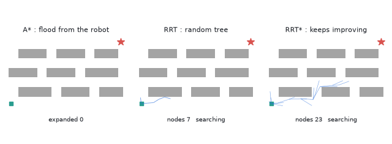
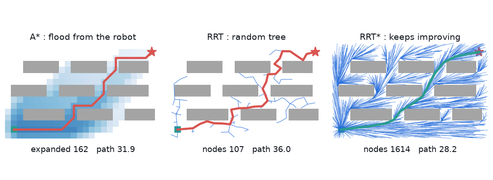
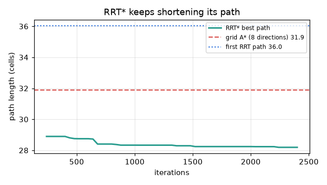

# What you are building toward

An animated warehouse with shelves. On the left, A* floods outward from the robot and the route appears when it reaches the shelf. In the middle, an RRT tree grows between the shelves and finds a wiggly path. On the right, RRT* keeps improving its path as it samples. Live counters show expanded nodes, tree size and path length. Your goal over the coming sessions: build all three planners yourself, then make the routes smooth and drivable.

*Target: A* flood-fill, an RRT tree and RRT* improving, with live counters*

*Target still: three planners on the same warehouse*

*Target: RRT* path length falls toward the optimum while sampling continues*

These results come from a private reference build. The code is not published; the roadmap shows the path so you can build your own.

Live links:

- [Math Visual Studio (open the Studio and explore geometry and graphs)](https://krunalpanchal1995.github.io/studio/)
