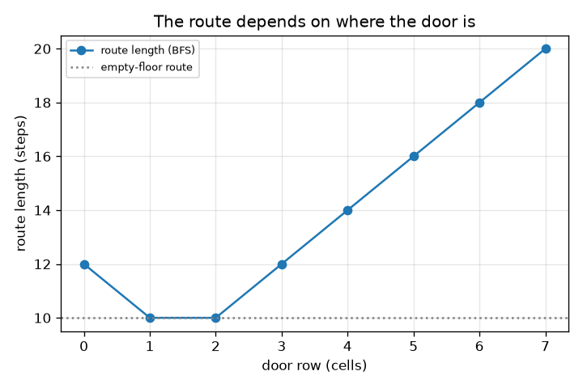
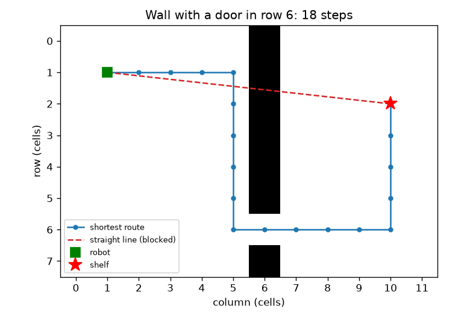

# Session 1: The shortest path is not the straight line

*Level 1 (conceptual interactive model) · about 60 minutes · openpathplanner*

> This is a simplified educational model. It is not a validated design tool and must not be used for real structures, electrical installations, vehicles, industrial processes or medical decisions.

**Prerequisites**

- Counting and the distance formula (Pythagoras).
- You have read PRIMER.md and run `python start.py 1` once.

**Learning objectives.** After this session you can:

- Describe a warehouse floor as a grid of free and blocked cells.
- Explain why the best route around a wall is longer than the straight line.
- Find a shortest route by breadth-first search (BFS) and read off its length in steps.
- Read a graph of route length against the position of the door in a wall.

## A. Real-world problem
A warehouse robot at the left of the floor must reach a shelf at the right. A long wall with one door stands between them. The straight line from robot to shelf runs through the wall, so the robot must walk to the door and back. How long is the real route, and how can a program find it without trying every possible walk? This is a simplified teaching model, not software for controlling a real robot.

## B. Concept and theory
We cut the floor into square cells. Each cell is free or blocked. The robot moves one cell at a time up, down, left or right, and every move costs one step. Breadth-first search (BFS) explores the floor in rings: first all cells one step from the robot, then all cells two steps away, and so on. The first time a ring touches the shelf, the number of the ring is the fewest possible steps. For cells dx columns and dy rows apart, the straight-line distance is sqrt(dx^2 + dy^2), but on an empty floor the 4-move route needs dx + dy steps, and any wall can only make the route longer, never shorter.

| Symbol | Meaning | Unit |
|---|---|---|
| dx, dy | columns and rows between robot and shelf | cells |
| steps | number of moves in a route | steps (1 step = 1 cell) |
| d | row of the door in the wall | cells |
| s | row of the shelf | cells |

**Assumptions**

- The floor is flat; the robot is a point that fills one cell.
- Moves are up, down, left, right only, each costing 1 step.
- The wall is in column 6 and has exactly one door; robot at column 1, row 1; shelf at column 10.
- The shelf cell is free to stand on.

$$ \text{straight line}=\sqrt{dx^2+dy^2} $$

$$ \text{empty floor, 4 moves: } dx+dy $$

$$ \text{steps}=(10-1)+|1-d|+|d-s|=9+|1-d|+|d-s| $$

## C. Visual explanation
The first figure shows the 12 by 8 floor. Grey cells are the wall, the red dashed line is the straight line that the wall blocks, and the blue line is the shortest route through the door in row 6: 18 steps against a straight line of 9.06 cells. The second figure plots the route length against the row of the door. The best doors are rows 1 and 2 with 10 steps, the same as on an empty floor, because the robot never has to leave its way. A door in row 7 costs 20 steps.

*Route length against door row: best at rows 1 and 2 (10 steps), worst at row 7 (20 steps).*

*A wall with a door in row 6: the shortest route is 18 steps; the straight line is blocked.*

## D. Interactive simulation
Run the lesson (`python start.py 1`), then open the live app: [Session 1: the robot, the wall and the door](https://krunalpanchal1995.github.io/openpathplanner/session-01/) (or `app.html` in this folder). Move the door slider and watch the blue route stretch and shrink, then switch to the graph view. Move the shelf row and see how the best door row follows it.

**Challenge.** Make the route to the shelf at most 11 steps long.

## E. Worked example and experiment
**Problem.** The door is in row 6 and the shelf is in row 2. Find the number of steps, the straight-line distance and the extra steps caused by the wall.

1. The robot starts at column 1, row 1. The shelf is at column 10, row 2. The robot must cross from column 1 to column 10: 9 steps to the right.
2. To pass the wall it must stand in row 6: from row 1 down to row 6 is |1 - 6| = 5 steps.
3. After the door it must go from row 6 to the shelf row 2: |6 - 2| = 4 steps.
4. Total = 9 + 5 + 4 = 18 steps. BFS in the checkpoint also returns 18.
5. Straight line = sqrt(9^2 + 1^2) = sqrt(82) = 9.06 cells. On an empty floor the route would be 9 + 1 = 10 steps, so the wall costs 8 extra steps.

**Answer.** The route has 18 steps; the straight line is 9.06 cells; the wall adds 8 steps.

**Experiment.** Draw the floor on squared paper, shade the wall and walk a coin from the robot to the shelf, counting moves. You should count 18. Real robots differ from the model: they have a width, so the door must be wider than the robot, and they can cut diagonally, which Session 2 adds. The model is exact for the grid, but the grid is only an approximation of a real floor.

## F. Assessment and design challenge
**Question type A: Conceptual.** Why is the shortest route to the shelf longer than the straight line, and why can BFS stop as soon as it reaches the shelf?

Hint

Think about what the wall blocks, and about the order in which BFS visits cells.

Step-by-step solution

The straight line passes through blocked cells, so the robot cannot follow it; any allowed route must bend through the door, so it is longer. BFS visits all cells one step away before any cell two steps away, and so on, so the first time it reaches the shelf it has used the fewest possible steps. No later visit can be shorter.

**Question type B: Numerical.** The door is in row 4 and the shelf is in row 2. How many steps is the route, and what is the straight-line distance? Check that the route is not shorter than the straight line.

Hint

Use steps = 9 + |1 - d| + |d - s|.

Step-by-step solution

steps = 9 + |1 - 4| + |4 - 2| = 9 + 3 + 2 = 14 steps. Straight line = sqrt(82) = 9.06 cells. 14 is larger than 9.06, as it must be. Units: steps of one cell.

**Question type C: Graph and simulation interpretation.** In the graph of route length against door row (shelf in row 2), which door rows give the shortest route, what is that length, and why is it not smaller?

Hint

Find the lowest points and compare with the empty-floor line.

Step-by-step solution

Door rows 1 and 2 give 10 steps. 10 = 9 + 1 is the empty-floor value (9 columns and 1 row), so no wall position can do better: a wall can only add steps. Rows 0 and 3 give 12 steps, and row 7 gives 20.

**Question type D: Design and optimisation challenge.** Design: two kinds of orders go to shelves in row 2 and row 6, equally often. Choose the door row that minimises the total steps of one trip to each shelf. What is the total? What real-world factor does this model ignore that might change your choice?

Hint

Add the two formulas for each door row 0 to 7 and compare.

Step-by-step solution

Totals for door rows 0 to 7 are 28, 24, 24, 26, 28, 30, 32, 36. Rows 1 and 2 tie with 24 steps. The model ignores congestion: if many robots use one door they queue, so a real design might add a second door. It also ignores door width and robot size.

Score yourself with [RUBRIC.md](../../RUBRIC.md). Print the [activity sheet](activity_sheet.md) to work on paper.

## Common misconceptions
| Common misconception | What is actually true |
|---|---|
| The shortest path is the straight line. | The straight line is only a lower bound. With walls, the shortest route is longer. |
| BFS tries every possible path. | BFS visits each cell once, in rings of equal distance, which is far less work. |
| A wall can sometimes make the route shorter. | A wall only removes options, so the route can stay the same or get longer, never shorter. |
| There is only one shortest route. | Often several routes tie (for example moving right first or down first); BFS returns one of them. |

## Glossary
- **grid**: a floor cut into square cells, each free or blocked
- **BFS**: breadth-first search: explore in rings of equal step count
- **step**: one move to a neighbouring cell
- **lower bound**: a value the true answer can never be below

## Finish
1. Do the three coding tasks in [exercises.md](exercises.md).
2. Run `python start.py 1` again after your changes. It ends with the checkpoint; when it prints `PASS`, you are done. (Checkpoint only: `python start.py check 1`.)

Next: [Session 2](../session-02/README.md)
