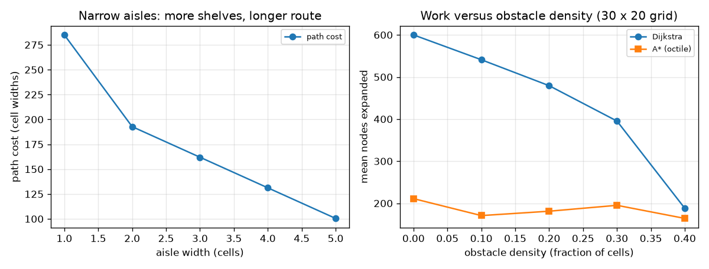
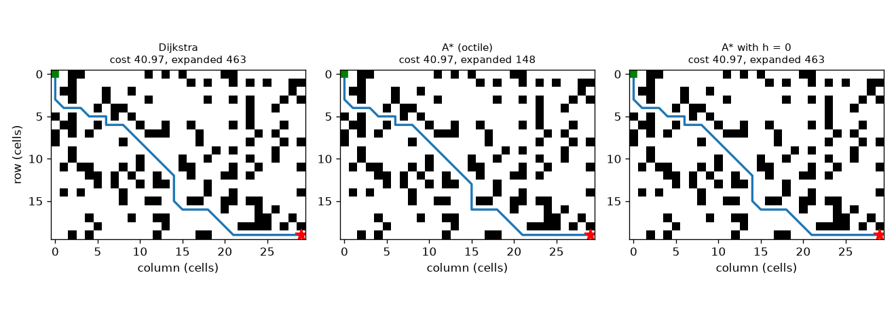

# Session 2: Graphs, Dijkstra and A*

*Level 2 (mathematical engineering model) · about 80 minutes · openpathplanner*

> This is a simplified educational model. It is not a validated design tool and must not be used for real structures, electrical installations, vehicles, industrial processes or medical decisions.

**Prerequisites**

- Session 1: grids and BFS.
- The idea of a priority queue is explained in Section B.

**Learning objectives.** After this session you can:

- Turn a grid into a graph with edge costs 1 and sqrt 2 (4- or 8-connected).
- Write BFS and Dijkstra (with heapq) and check them on hand-checkable grids.
- Explain why an admissible heuristic keeps A* optimal, and check admissibility numerically.
- Compare nodes expanded by Dijkstra and A*, and use the comparison to solve a design problem.

## A. Real-world problem
Real warehouse robots can move diagonally, and a diagonal move is longer than a straight one (sqrt 2 times). So 'fewest steps' is no longer 'cheapest route'. Also, a robot that thinks for a long time wastes time and battery, so we care about how many cells the search looks at. How wide should the aisles of a new warehouse be if we want many shelves but short routes? (Simplified model; not for real robot control.)

## B. Concept and theory
A node is a free cell. An edge joins neighbouring cells. In 4-connection a move up, down, left or right costs 1. In 8-connection the four diagonal moves cost sqrt 2 = 1.414; a diagonal may not cut a corner, so both cells beside it must be free. BFS minimises the number of moves; it is correct for cost only when all edges cost the same. Dijkstra keeps a priority queue (heapq) ordered by g, the cheapest known cost from the start, and always finishes the cheapest waiting node, so the first time it finishes the goal the cost is minimal. A* orders the queue by f = g + h, where h(n) estimates the cost still to go. If h never overestimates the true remaining cost (h is admissible), A* still returns the cheapest path: when the goal is finished with cost C, every node n on a truly cheaper path would have f(n) = g(n) + h(n) <= its true total cost < C, so it would have been finished earlier. A good h focuses the search toward the goal, so fewer nodes are expanded. Manhattan distance dx + dy is admissible on a 4-connected grid; octile distance (dx + dy) + (sqrt 2 - 2) min(dx, dy) is admissible (it is exact on an empty floor) on an 8-connected grid. Expanded nodes means nodes taken from the queue and finished; it is our measure of work.

| Symbol | Meaning | Unit |
|---|---|---|
| g(n) | cheapest known cost from the start to node n | cell widths |
| h(n) | estimated cost from n to the goal | cell widths |
| f(n) | g(n) + h(n), the queue priority | cell widths |
| dx, dy | columns and rows between n and the goal | cells |
| w | weight multiplying h (w = 1 is the normal A*) | no unit |

**Assumptions**

- Cells have width 1; edge costs are 1 and sqrt 2.
- A diagonal move never cuts a corner.
- The robot is a point; obstacles are whole cells.
- Ties in the queue are broken by the smaller cost so far g, then by cell order.

$$ f(n)=g(n)+h(n) $$

$$ h_{\mathrm{Manhattan}}=dx+dy $$

$$ h_{\mathrm{octile}}=(dx+dy)+(\sqrt2-2)\min(dx,dy) $$

$$ h(n)\le h^*(n)\ \text{for every }n\ \Rightarrow\ \text{A* returns a cheapest path} $$

## C. Visual explanation
The first figure runs Dijkstra, A* and A* with h = 0 on the same 25 percent obstacle warehouse: Dijkstra and A* both find cost 40.971, but Dijkstra expands 463 nodes and A* only 148; A* with h = 0 is the same as Dijkstra. The second figure has two panels: the path cost of a serpentine warehouse against aisle width (narrow aisles give long routes), and the mean nodes expanded against obstacle density, where A* stays below Dijkstra at every density.

*Left: path cost against aisle width. Right: mean expanded nodes against obstacle density.*

*Dijkstra, A* and A* with h = 0 on a 25 percent obstacle grid: same cost, A* expands 148 instead of 463 nodes.*

## D. Interactive simulation
Run the lesson (`python start.py 2`), then open the live app: [Session 2: heuristics on an empty floor](https://krunalpanchal1995.github.io/openpathplanner/session-02/) (or `app.html` in this folder). Move the dx and dy sliders and watch the 4-move route (red), the 8-move route (blue) and the heuristic values. Open the graph view and raise the weight w above 1.

**Challenge.** For a goal 10 columns and 4 rows away, find a heuristic weight that makes the estimate overestimate the true cost (not admissible).

## E. Worked example and experiment
**Problem.** On the 5 by 3 grid with a wall in column 2 (gap only in the bottom row), the robot at (0, 0) must reach (4, 1). Find the cheapest cost with 4 moves and with 8 moves, and compare with the Manhattan lower bound.

1. Grid rows: 'S.#..', '..#.G', '.....'. Only row 2 passes the wall at column 2.
2. Manhattan distance from (0, 0) to (4, 1) is 4 + 1 = 5. This is a lower bound for 4 moves.
3. 4 moves: go down 2 rows to (0, 2), right 4 to (4, 2), up 1 to (4, 1): 2 + 4 + 1 = 7. The wall adds 2.
4. 8 moves: (0, 0) down to (0, 1) costs 1, diagonal to (1, 2) costs sqrt 2, right to (2, 2) and (3, 2) cost 1 + 1, diagonal up to (4, 1) costs sqrt 2 (both cells beside it are free).
5. Total = 1 + sqrt 2 + 1 + 1 + sqrt 2 = 3 + 2 sqrt 2 = 5.828. The diagonal from (1, 1) to (2, 2) is not allowed because (2, 1) is a wall.

**Answer.** Cost 7 with 4 moves (above the Manhattan bound 5) and 3 + 2 sqrt 2 = 5.828 with 8 moves. BFS, Dijkstra and A* agree on these values.

**Experiment.** Print the grid, lay a string along the cheapest route and measure it against the cell width with a ruler (diagonal = 1.414 cell widths). Real robots differ: turning costs time, and a diagonal squeezes past the corner of a shelf, so the real clearance is smaller than the model suggests. The model counts only distance, not time or energy.

## F. Assessment and design challenge
**Question type A: Conceptual.** Why does an admissible heuristic keep A* optimal, and what goes wrong if h overestimates?

Hint

Compare f = g + h of a node on the cheapest path with the cost of the path A* has already found.

Step-by-step solution

If h never overestimates, every node on a truly cheapest path has f at most the cheapest cost, so it is finished before any more expensive goal. If h overestimates, a node on the cheapest path can get an f above the cost of a worse path, so A* may finish the goal with the worse path first. In the lesson, multiplying the octile heuristic by 3 expands far fewer nodes but can return a longer path.

**Question type B: Numerical.** For a goal dx = 3 columns and dy = 1 row away on an empty 8-connected floor, compute the Manhattan, octile and straight-line distances and say which are admissible.

Hint

Octile = (dx + dy) + (sqrt 2 - 2) min(dx, dy).

Step-by-step solution

Manhattan = 4. Octile = 4 + (1.414 - 2) * 1 = 3.414 (this is 2 + sqrt 2, which is also the true cost: two straight moves and one diagonal). Straight line = sqrt(10) = 3.162. On an 8-connected grid Manhattan (4) is larger than the true cost 3.414, so it is NOT admissible; octile and straight line are admissible (the straight line is admissible but weaker, so it focuses the search less).

**Question type C: Graph and simulation interpretation.** In the density graph, how does the work of Dijkstra change as the density of obstacles grows, and why does A* expand fewer nodes at every density?

Hint

Look at the two curves and think about what the heuristic knows.

Step-by-step solution

Dijkstra's mean expanded nodes fall as density grows (from 600 with no obstacles to 188 at density 0.4) because only grids where a path exists are counted and the obstacles block the flood. A* expands fewer nodes at every density because its heuristic pulls the search toward the goal while Dijkstra expands everything closer than the goal in all directions.

**Question type D: Design and optimisation challenge.** Design: in the 30 by 25 serpentine warehouse you need at least 200 shelf cells and a path cost of at most 170. Which aisle width (1 to 5 cells) do you choose, and what is the trade-off?

Hint

Read the shelf cells and path cost for each aisle width from the lesson output.

Step-by-step solution

Aisle width 1 gives 464 shelf cells but cost 285.00; width 2 gives 290 cells and 192.73; width 3 gives 232 cells and 161.97; width 4 gives 174 cells and 131.21; width 5 gives 116 cells and 100.46. Only width 3 has at least 200 cells and cost at most 170. Trade-off: narrower aisles store more but make routes longer and, in a real warehouse, make passing impossible for two robots; wider aisles are faster but store less.

Score yourself with [RUBRIC.md](../../RUBRIC.md). Print the [activity sheet](activity_sheet.md) to work on paper.

## Common misconceptions
| Common misconception | What is actually true |
|---|---|
| BFS always finds the cheapest route. | BFS minimises the number of moves. With diagonals costing sqrt 2 it can return a costlier route (the trap grid in the lesson: 6.243 against 6.0). |
| A* is always faster than Dijkstra. | A* is never worse in expanded nodes with an admissible h, but in a single narrow corridor both expand the same nodes (aisle width 1: 286 each). |
| Any heuristic that points toward the goal is fine. | It must never overestimate. Manhattan overestimates on an 8-connected grid, and a weight above 1 also overestimates. |
| A* with h = 0 is a different algorithm. | With h = 0, f = g, which is exactly Dijkstra. |

## Glossary
- **graph**: nodes joined by edges that have costs
- **priority queue**: a waiting list that always gives back the item with the smallest priority; heapq in Python
- **heuristic**: a guess of the cost still to go
- **admissible**: never overestimates the true remaining cost
- **expanded node**: a node taken from the queue and finished; our measure of work

## Finish
1. Do the three coding tasks in [exercises.md](exercises.md).
2. Run `python start.py 2` again after your changes. It ends with the checkpoint; when it prints `PASS`, you are done. (Checkpoint only: `python start.py check 2`.)

Next: [Session 3](../session-03/README.md)
