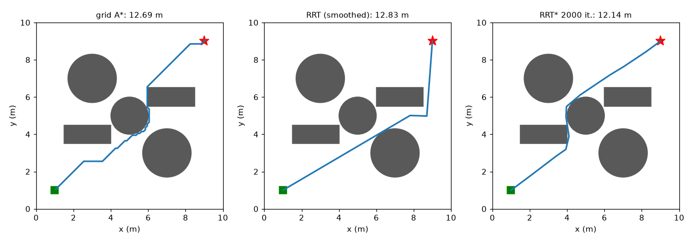
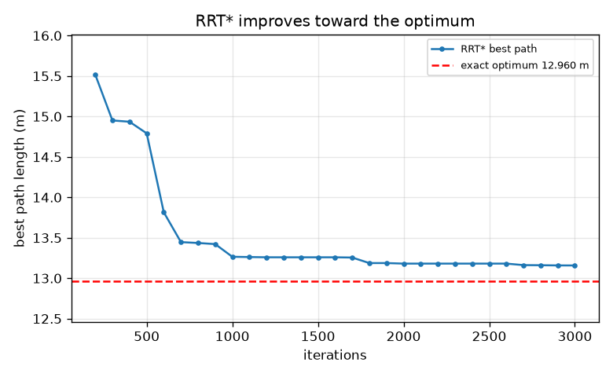
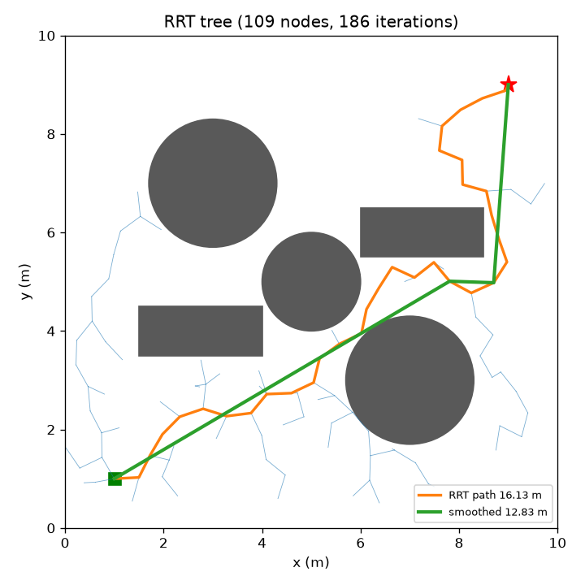

# Session 3: Continuous space: RRT, RRT* and validation

*Level 3 (simulation and validation) · about 90 minutes · openpathplanner*

> This is a simplified educational model. It is not a validated design tool and must not be used for real structures, electrical installations, vehicles, industrial processes or medical decisions.

**Prerequisites**

- Session 1: grids and BFS.
- Session 2: Dijkstra, A* and heuristics.

**Learning objectives.** After this session you can:

- Test whether a segment collides with a circle or a rectangle, and verify the tests on known cases.
- Build an RRT with a seeded random generator and smooth its path by shortcutting.
- Validate planners against the exact shortest path around a wall (a polyline through its corners).
- Measure a failure case (narrow passage) and the effect of step size and iterations.

## A. Real-world problem
A grid forces the robot to move in eight directions and costs memory when the map is large and detailed. In continuous space a planner can use any direction, but we cannot list all positions. Sampling-based planners such as RRT (rapidly-exploring random tree) throw random points on the map and grow a tree of free moves. They are fast, but is the path good, and does the planner always find one? We answer with measurements against an exact answer. This is a simplified teaching model, not for controlling real robots or vehicles.

## B. Concept and theory
Obstacles are circles (centre, radius) and rectangles. A segment collides with a circle if its closest point to the centre is nearer than the radius. A segment collides with a rectangle if, after clipping it to the four sides (Liang-Barsky), a piece is left whose midpoint is strictly inside; touching an edge or a corner is allowed, because the shortest path around a wall must touch the wall corners. RRT repeats: sample a random point (with probability 0.05 the goal itself), find the nearest tree node, step from it toward the sample by at most the step size, and add the new node if that short segment is free. It stops when the goal is visible from the new node. RRT is probabilistically complete: if a path exists, the chance of finding it tends to 1 as iterations grow, but it does not promise the shortest path, and narrow passages need many samples. Shortcutting picks two points of the path and replaces everything between them by a straight segment if it is free. RRT* chooses as parent the nearby node that gives the lowest cost-from-start and rewires neighbours through the new node when that is cheaper, so its best path improves toward the optimum as iterations grow. Around a single wall the optimum is a polyline through the two top corners of the wall. Grid A* is optimal on the grid it is given, but the grid forces 8 directions; neither A* nor RRT gives both optimality and freedom from the grid for free.

| Symbol | Meaning | Unit |
|---|---|---|
| step | largest distance the tree grows per iteration | m |
| radius | neighbourhood size for RRT* parent choice and rewiring | m |
| cost(n) | length of the tree path from the start to node n | m |
| t, h | wall thickness and wall height | m |
| res | grid cell size for grid A* | m |

**Assumptions**

- The robot is a point in a 10 m by 10 m map; obstacles are not inflated.
- Obstacles are circles and axis-aligned rectangles; touching is allowed.
- Random numbers come from a seeded generator, so runs repeat.
- Grid A* uses 0.1 m cells and 8-connection; times depend on the computer and are not claimed here.

$$ \text{closest point on segment: } t^*=\mathrm{clip}\!\left(\frac{(c-p)\cdot(q-p)}{|q-p|^2},0,1\right),\quad \text{hit if } |p+t^*(q-p)-c|<r $$

$$ \text{exact wall path: } L=2\sqrt{(x_0-x_s)^2+(h-y_s)^2}+t\quad (x_0=5-t/2) $$

$$ \text{RRT* parent: } \arg\min_{j\in \mathrm{near}}\ \mathrm{cost}(j)+|x_j-x_{\mathrm{new}}| $$

## C. Visual explanation
The first figure shows an RRT tree on a map with three circles and two rectangles: the tree has spread over the free space, the raw path is 16.130 m and the smoothed path is 12.829 m. The second figure plots the best RRT* path length against iterations on the wall map: it falls from 14.792 m at 500 iterations to 13.158 m at 3000 iterations, toward the red dashed exact optimum of 12.960 m. The third figure compares grid A*, smoothed RRT and RRT* on the clutter map.

*Grid A*, smoothed RRT and RRT* on the same map.*

*RRT* best path length against iterations, approaching the exact optimum 12.960 m.*

*An RRT tree on the clutter map: raw path (orange) and smoothed path (green).*

## D. Interactive simulation
Run the lesson (`python start.py 3`), then open the live app: [Session 3: the exact path around a wall](https://krunalpanchal1995.github.io/openpathplanner/session-03/) (or `app.html` in this folder). Move the wall height, thickness and the start/goal height, and watch the exact path (through the wall corners) and the plotted length.

**Challenge.** Make the exact shortest path at most 10 m long.

## E. Worked example and experiment
**Problem.** A thin wall (x from 4.8 to 5.2) rises from below the map to a height of 6 m. The robot starts at (1, 1) and the goal is at (9, 1). Find the exact shortest path and compare it with the straight line.

1. The shortest path over the top is a polyline: start, left top corner (4.8, 6), right top corner (5.2, 6), goal.
2. First leg: dx = 4.8 - 1 = 3.8 and dy = 6 - 1 = 5, so length = sqrt(3.8^2 + 5^2) = sqrt(39.44) = 6.280 m.
3. Last leg is the mirror image: 6.280 m. The segment between the corners is 5.2 - 4.8 = 0.4 m.
4. Total = 2 * 6.280 + 0.4 = 12.960 m. A visibility-graph Dijkstra in the checkpoint finds the same polyline and length.
5. The straight line is 8 m, so the wall adds 4.960 m. Grid A* with 0.1 m cells returns 13.607 m (5 percent above), and RRT* after 3000 iterations returns 13.158 m (1.5 percent above).

**Answer.** The exact shortest path is 12.960 m, through the two top corners of the wall; the straight line, 8 m, is blocked.

**Experiment.** Pin a cardboard wall on a table, tie a string from the start to the goal over the top and pull it tight: the string follows the corners and its length is the exact answer. Compare with the grid A* and RRT* results. Differences arise because the grid cuts corners in only eight directions and RRT* samples randomly; the string is exact but a real robot has width, so it must keep clear of the corners, which makes the real path longer than the model.

## Real-world application and mini-project: Plan the pick route for a warehouse robot
A 36 by 18 cell warehouse has nine shelf blocks, a dock at (1, 16) and four pick points at (6, 5), (21, 9), (31, 5) and (12, 13), to be visited in this order before returning to the dock. Each cell is 1 m wide (a simplifying assumption). Use `warehouse_grid`, `DOCK`, `PICKS` and `pick_route` from Session 3. Report the total route length and the number of nodes A* expanded, then repeat with Dijkstra (call `astar_cells` with weight=0.0 for each leg) and compare the work.

**Deliverable:** A script that prints the length and expanded nodes for A* and for Dijkstra over the four legs plus the return leg, and saves a picture of the warehouse with the whole route drawn on it.

**Success looks like:** A* reports a length of 82.97 cells and 244 expanded nodes; Dijkstra reports the same length and 1209 expanded nodes; the straight-line sum 70.39 is below the route length.

## F. Assessment and design challenge
**Question type A: Conceptual.** RRT is probabilistically complete but not optimal; A* is optimal on the grid. Explain what each statement means and why neither planner gives both properties for free.

Hint

Think about what a random tree does after it finds the goal, and about what a grid does to directions.

Step-by-step solution

Probabilistically complete: if a path exists, the probability that RRT finds one tends to 1 as iterations grow, but RRT stops at the first path it finds, which is typically wiggly. A* gives the cheapest path among the grid's moves, but the grid allows only eight directions (and needs memory for every cell), so its path can be longer than the best true path (13.607 m against 12.960 m on the wall map). RRT* adds optimality only in the limit of many iterations and costs more time per iteration.

**Question type B: Numerical.** A thin wall (x from 4.8 to 5.2, height 6 m) has the start at (1, 3) and goal at (9, 3). Compute the exact shortest path length. Check it against the 8 m straight line.

Hint

Use L = 2 sqrt((4.8 - 1)^2 + (6 - 3)^2) + 0.4.

Step-by-step solution

L = 2 sqrt(3.8^2 + 3^2) + 0.4 = 2 sqrt(14.44 + 9) + 0.4 = 2 * 4.841 + 0.4 = 10.083 m. It is longer than the straight line (8 m), as it must be.

**Question type C: Graph and simulation interpretation.** From the RRT* cost graph, what happens to the best path length between 500 and 3000 iterations, and can it ever go below the red dashed line?

Hint

Look at the trend and at what the red line is.

Step-by-step solution

The best length falls from 14.792 m to 13.158 m and never increases (rewiring only lowers costs). It can never go below the red line, because the red line, 12.960 m, is the exact shortest path; RRT* only approaches it.

**Question type D: Design and optimisation challenge.** Design: the narrow-passage map has a wall with a gap. Over 100 seeds with 1000 iterations and step 0.5 m, RRT succeeds 12 times for a 0.05 m gap, 33 for 0.1 m, 82 for 0.3 m and 100 for 1 m. A robot needs a gap of at least 0.3 m anyway. Which settings would you choose and what does the failure rate tell you about trusting RRT?

Hint

Compare success rates and think about how many seeds (retries) you can afford.

Step-by-step solution

A robot with a minimum 0.3 m gap still sees 18 failures in 100 runs at 1000 iterations, so give RRT more iterations (500 iterations gave 24 successes for a 0.1 m gap and 1000 gave 33) or retry with several seeds, and keep a fallback such as A* on a grid fine enough to see the gap. Trust: RRT can fail even when a path exists; a failure is not a proof that none exists.

Score yourself with [RUBRIC.md](../../RUBRIC.md). Print the [activity sheet](activity_sheet.md) to work on paper.

## Common misconceptions
| Common misconception | What is actually true |
|---|---|
| RRT finds the shortest path. | It finds a path, usually a wiggly one (16.130 m against the straight-line bound 11.314 m on the clutter map); smoothing and RRT* shorten it. |
| If RRT fails, there is no path. | RRT is only probabilistically complete: with a 0.05 m gap it fails in 88 of 100 runs at 1000 iterations. |
| A bigger step is always better. | A bigger step finds a path in fewer iterations (60 against 440) but gives longer raw paths (15.97 m against 15.28 m on the clutter map) and may fail to enter tight places. |
| A* on a grid is exactly optimal. | It is optimal on the grid only; the grid path around the wall is 13.607 m while the exact path is 12.960 m. |

## Glossary
- **RRT**: rapidly-exploring random tree: a planner that grows a tree by random sampling
- **probabilistically complete**: the chance of finding a path tends to 1 as the number of samples grows
- **shortcutting**: replacing part of a path by a straight free segment
- **RRT***: RRT with best-parent choice and rewiring, which improves toward the optimum
- **visibility graph**: nodes at corners joined if they can see each other; exact shortest paths lie on it
- **goal bias**: sampling the goal itself with a small probability

## Finish
1. Do the three coding tasks in [exercises.md](exercises.md).
2. Run `python start.py 3` again after your changes. It ends with the checkpoint; when it prints `PASS`, you are done. (Checkpoint only: `python start.py check 3`.)

Next: the [roadmap](../../promo/roadmap.md). Session 4 is yours to build.
